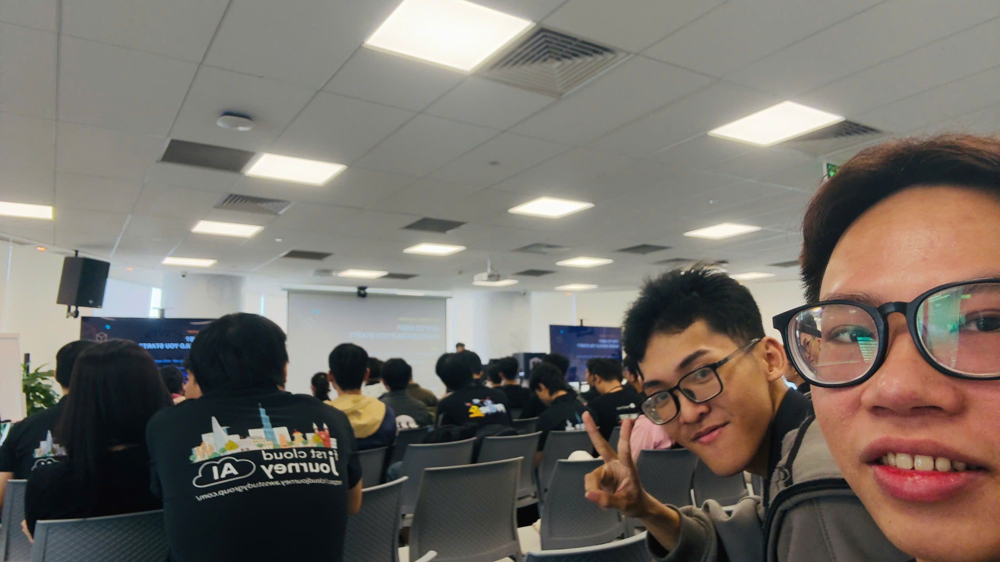
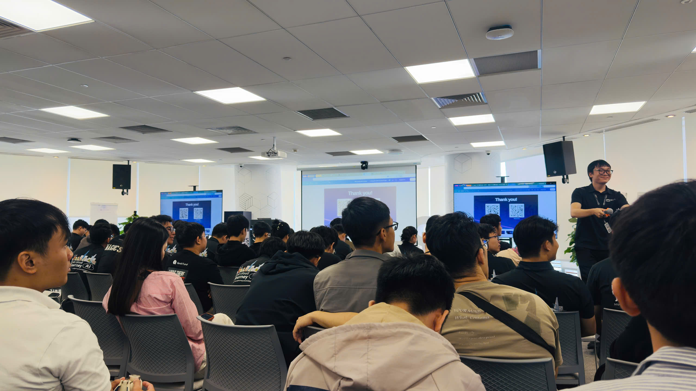
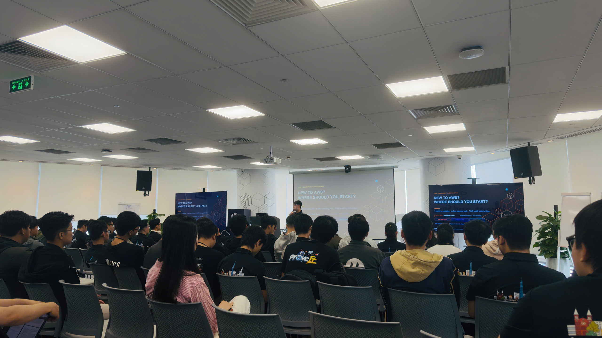
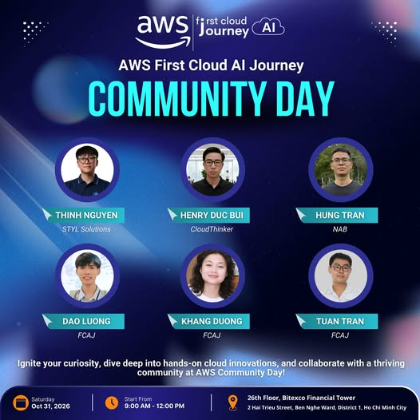

# Event Report: "AWS First Cloud AI Journey Community Day 2026"

**Event Name:** AWS First Cloud AI Journey Community Day 2026

**Date & Time:** Saturday, 31/10/2026, 9:00 to 12:00

**Location:** Floor 26, Bitexco Financial Tower, 02 Hải Triều, Sài Gòn Ward, Ho Chi Minh City

**Role:** Attendee

### Event Objectives
* Bring fresh views on technology, from new ideas to hands-on experience.
* Help attendees update their knowledge, broaden their views and connect with the community through talks across many areas of technology.
* Give students and tech enthusiasts a chance to find inspiration, set their direction and prepare for the road ahead.
* The event poster says the goal is to spark curiosity, go deep into hands-on cloud computing and work together with the community at AWS Community Day.
* The morning had four technical sessions: lessons from building a serverless web game, Lambda Web Function, asynchronous systems with Amazon SQS, and how to start contributing to open source.

### Speakers
* **Thinh Nguyen** - STYL Solutions
* **Henry Duc Bui** - CloudThinker
* **Hung Tran** - NAB, one of the top 25 contributors to the AWS SDK, started contributing to open source about 2 years ago
* **Dao Luong** - FCAJ
* **Khang Duong** - FCAJ
* **Tuan Tran** - FCAJ

### Key Highlights

#### Lessons from building a serverless card-game website on AWS
This session described a turn-based, real-time card-game website that a team of 4 built over about 3 months. The speaker introduced Lambda as an event-driven function service, which means code only runs when an event is sent to it.
* **Three ways to invoke Lambda:**
  * Synchronous invocation through API Gateway: the user takes an action, API Gateway passes the request to Lambda and waits for the result.
  * Event-driven invocation through EventBridge. The speaker compared EventBridge to calling ahead to order food and picking it up at the agreed time, or to an alarm clock that rings when the time comes. This service is strong at routing and filtering events.
  * Asynchronous invocation through SQS. SQS is a temporary queue that keeps data from flooding the database all at once.
* **Authentication:** users sign in through Cognito to get a JWT, and every request after that is checked against the JWT for authentication.
* **Leaderboard:** every 10 minutes, a scheduled task reads DynamoDB again and updates the leaderboard, using a GSI key for faster queries. Players also have a refresh button to update right away without waiting the full 10 minutes.
* **Example of 1,000 matches ending at the same time:** if all 1,000 matches are written straight to the database, the system can go down. The team puts the results into a queue first, then a Lambda takes the messages out one by one and writes them gradually. This queue layer works like the system's "shock absorber".
* **Why DynamoDB and not ElastiCache:** ElastiCache suits games that need absolute precision down to each click, like FPS shooters. The team's game also runs in real time but does not need that level of timing precision, so DynamoDB's read, write and response speed is enough. The speaker compared DynamoDB to a bookshelf arranged in rows, where any book is easy to pick out, and a GSI to splitting the books into sections so they can be found faster.
* **TypeScript and Lambda:** the project was written in TypeScript, a language that extends JavaScript. According to the speaker, the team's Lambda only accepted JavaScript code, so the team had to build everything into standard JavaScript before uploading it to Lambda.

#### Mistakes the team made and how they handled them
* **"Ghost" requests from SQS long polling:** the system had two SQS queues, one handling the end of a match and one handling timeouts during a match. Lambda kept long polling, once every 20 seconds, even when no one was on the website. The speaker compared it to a bubble-tea shop employee running to the door every 20 seconds to check for customers and then going back in. In one month, mostly from the team's own testing, the system used roughly 863,000 requests, close to the free tier's 1 million SQS request limit. The team removed the timeout queue and used EventBridge as a "watchdog":
  * If both players go idle or close the tab for longer than the time allowed per turn (the speaker mentioned about 15 or 30 seconds), the system writes the data down and then fully deletes the match, leaving nothing behind.
  * If only one player goes idle, the match is kept to wait for handling.
* **One IAM Role holding every policy:** the team put all permissions (Lambda to SQS, Lambda to DynamoDB...) into one shared role, which breaks the principle of least privilege. Each Lambda should have had its own role, so that when one role has a problem, only the Lambda attached to that role is affected and the other Lambdas are not dragged down with it.
* **Storing secret keys directly in Lambda:** the team once kept both the secret key and the access key right inside Lambda, and admitted this was a serious mistake. Secrets Manager and KMS suit high-security environments with a VPC and a database inside the VPC. With DynamoDB, the team only needed to store the keys in Systems Manager. The team also gathered the table names into a single variable in Systems Manager, instead of declaring environment variables again in each Lambda as before. The old way easily drifted out of sync, because every new Lambda needed the full set of variables declared again.
* **Not using Lambda versions:** the website was hosted on Amplify with two branches, dev and main, but both branches shared the same Lambda. The team assumed that pushing code only to dev would leave main untouched, but in reality, every code update for dev also affected production. The right way is:
  * Once a Lambda build runs well, lock it as a fixed version for production on the main branch.
  * Later updates go to $LATEST by default, meaning the newest version, and only the dev branch uses it.
* **Environment errors when building on Amplify:** the team used Next.js version 19 and hit environment errors during deployment. The repo was not a monorepo, so the environment variable configuration on Amplify was very important. The lesson is to read the docs to see which framework versions the service supports, and not to take the latest version by default.
* **Three AWS accounts for one team:** the team put Lambda and DynamoDB in different accounts. Managing them centrally would require AWS Organizations, which takes considerable effort and cost. The team later planned to migrate and consolidate all services into one account.
* **Moving to infrastructure as code:** the team no longer wanted to configure each AWS service by hand, so they moved to CDK. When deployed to CloudFormation, all services are created automatically.
* **Final architecture, following the flow of one match:**
  * Two API Gateway endpoints: HTTP for basic GET/POST flows, WebSocket for the real-time match flow.
  * Step 1, connect: the player is given an ID, stored together with the match. If the connection drops or the tab is closed, the system looks up the ID to find the match still in progress, and the player can rejoin.
  * Step 2, play cards: each move is written to DynamoDB, including which player played which card and the buff and debuff effects that come with it.
  * Step 3, handle timeouts: when a player goes idle or quits, EventBridge handles it first and then writes to the database.
  * Step 4, end the match: the result goes into the queue, another Lambda takes each message and writes it to the database, and the leaderboard uses a GSI key to update faster.
* **Demo:** the game has deck building, a collection (cards not yet owned are shown in grey), creating game rooms with a code, a practice mode, ranking, profiles, automatic sign-out when signing in on another tab, idle handling and a surrender mechanism. The board has two rows of cards: the bottom row is the waiting cards, the top row is the active cards. The cards and music were made by an artist on the team. The game is not yet optimised for mobile.
* **Final advice from the talk:** when learning a service, read its documentation, and don't stop at knowing which services it integrates with. Permissions must follow the principle of least privilege.

#### Lambda Web Function and how Lambda handles requests
* **Interview question "How is Lambda different from EC2":** EC2 is a server you have full control over, while Lambda runs as a function. With the new feature, this answer changes.
* **Limits of the old mechanism:**
  * Each request is handled in its own environment on a microVM. When many requests arrive at once, the system keeps hitting cold starts, so it is slow.
  * API Gateway wraps the request into a JSON event, and Lambda needs an extra conversion layer to decode it, which adds latency.
  * Lambda charges for the time from start to finish, including time spent just waiting for the database to respond, for example when running a SELECT statement.
* **Explaining cold start with a 10-request chart:**
  * Each environment has two phases: initialisation and execution. Cold start happens in the initialisation phase, when Lambda has to set up a microVM and prepare the environment before running the function.
  * Requests 1, 2 and 3 all hit a cold start. Requests 4 and 5 arrive while the existing environments are still busy, so new environments also have to be initialised.
  * Requests 6, 7 and 8 arrive when the first environments are free and still "warm", so they are reused right away without initialisation.
  * Request 9 arrives when every environment is busy, so a new one has to be initialised again. Request 10 arrives just as the fourth environment finishes, so that environment is reused.
  * In short, if there is a free environment, Lambda reuses it first, and only when no free environment is left does it initialise a new one.
* **Lambda Web Function:**
  * Code and environment are packaged into a Docker image, with a port exposed to call into.
  * Inside, Express or FastAPI can be used to route the API, so API Gateway is almost no longer needed.
  * Supports concurrent requests: one microVM can handle 128 requests at the same time. Cold start still exists because it scales to 0 when there are no requests, but only on the first request. With 129 concurrent requests, Lambda sets up a second microVM, and with even more load it keeps adding microVMs.
* **CloudFront OAC:** requests go straight from CloudFront into Lambda, Lambda does not have to be exposed to the internet, and the API Gateway step and its cost can be removed.
* **New billing model:** only CPU processing time is charged, not time spent waiting for the database. According to the session, this can cut costs by about 40 to 70%.
* **Demo:**
  * An MBTI quiz website using CloudFront, S3 and Lambda, plus ECR to store the image after build. The website was accessed through the CloudFront URL, and attendees scanned a QR code to try it.
  * According to the recording, the first request took about 186 seconds because it had to pull the image and start the container before running the backend. More than 10 requests after that took only about 138 milliseconds.
  * In real use with steady traffic, the container is kept warm, so cold starts will not happen often.
* **Q&A: when to use classic Lambda, and when to use Lambda Web Function?**
  * Simple tasks like generating S3 URLs, sending notifications with EventBridge or small automation jobs should use classic Lambda, since no container packaging is needed.
  * Lambda Web Function has a longer cold start because it has to pull the image and run the container.
  * Lambda Web Function still keeps Lambda's 15-minute maximum run time.

#### Building asynchronous systems with Amazon SQS
The session had four parts: what synchronous is, what asynchronous is, SQS, and Q&A.
* **Real-world problem:** the team had integrated an AI service to generate content. With a direct call, users had to wait for the AI to respond and could not leave the page, because leaving meant losing the result. The team weighed SQS against another message queue and finally chose SQS as the intermediary:
  * The API service pushes a message into the queue and immediately returns a pending status to the user.
  * The AI service takes the message out and processes it.
  * The two services are separate, so the system is decoupled, easier to scale, and users can leave the page while waiting.
* **SQS concepts:**
  * The producer pushes messages into the queue, the consumer takes messages out to process.
  * The benefits mentioned include security, scalability and durability through storing multiple copies of each message.
* **Standard and FIFO:**
  * Standard can process out of order: you send 1, 2, 3, but they may not be processed exactly as 1, 2, 3.
  * FIFO keeps the exact send order. Messages with the same group ID have to wait for each other, so FIFO throughput is lower than Standard. Example from the session: messages 1 and 4 have group ID 1, messages 2 and 3 have group ID 2. While message 1 is being processed, message 4 has to wait, and likewise message 3 has to wait for message 2. With Standard, the four messages are processed without waiting for each other.
* **Visibility timeout:** the length of time the consumer holds a message to process it. In the session's example the timeout was set to 40: if the consumer takes longer than this, the message is handed to another consumer, which easily leads to duplicate processing. The fix is to extend the timeout when it is about to run out.
* **Long polling:** instead of asking constantly, the consumer waits up to 20 seconds. If the queue has a message, it is returned right away; if the queue is empty, an empty response is returned only after the 20 seconds. This reduces the number of requests to the queue.
* **Dead letter queue:** messages retried more than the allowed number of times are moved to a DLQ to be handled separately by a person or a Lambda, so constant retries don't overload the system.
* **Console demo:**
  * Create a queue named MyQ, type Standard.
  * Set visibility timeout to 30.
  * Look at the options for message retention period and receive message wait time, that is, long polling.
  * Dead letter queue is off by default. When turned on, you choose the target queue and the maximum number of retries; in the demo it was left off.
  * Create the queue, send a message, then pull the message right in the console.
* **Code demo:**
  * Initialise an SQS client to connect to SQS, specifying the queue name.
  * Send a message, the console prints the message ID, and the UI shows the queue has received the message.
  * Receive the message to process it, then delete it from the queue when done.
* **Combining with SNS:** to distribute one message to multiple queues, for example a server pushing logs to two services at once, SNS can be combined with SQS.
* **Q&A:** an attendee asked, for an e-commerce website, if payment has succeeded but the consumer fails before deleting the message from SQS, how do you stop the customer from being charged twice. The question was not fully answered during the session, and both sides agreed to continue the discussion after the event.

#### Getting started with open source contribution
The speaker split the contribution journey into stages: the first PR, the 10th PR, the 100th PR, and how to keep contributing when everyone has their own job.
* **What it's really like at the start:**
  * Depending on the repo, it can take about 6 months to get a few lines of code merged. Large projects have wide impact and their own release cycles, so a submitted PR may not be accepted.
  * In large repos, easy issues are often claimed by someone else very quickly, sometimes within half an hour to an hour.
  * The well-known projects you already use may not be the right place to start.
* **How to find your first task:**
  * Look for labels like "good first issue" or "ready to implement". These are clear tasks that maintainers deliberately leave for newcomers to get familiar with the process. In large projects, a bug report still has to be triaged to see whether it really is a bug and whether fixing it causes other bugs, so newcomers should only take tasks that are already clear.
  * Another tip is to look for large refactoring efforts that already have a template and a checklist of tasks, then take on small parts one at a time. The speaker used two repos as examples: one repo you can start working on right away, while the other has had a refactoring effort open for many years.
* **Getting a PR merged:**
  * The simpler and easier to understand a PR is, the better. Reviewers don't know who you are, and once it is merged, any bug becomes their responsibility, so you have to save them as much thinking as possible.
  * Split PRs into small pieces. A PR that does too many things without the reviewer understanding why is hard to get merged.
* **Mentoring programmes for newcomers:**
  * Paid programmes with a mentor, only about three rounds a year, requiring almost full-time work, suited to students or freelancers.
  * Monthly new-contributor meetups, mainly for introductions and discussion, with no tasks handed out, so you have to find your own.
* **Trap:** most newcomers get "stuck" on good first issues, jumping from one project to another without going deep into any of them.

### What I Learned
* **Choose the invocation style based on the nature of the work:**
  * Requests that need an immediate answer use synchronous calls through API Gateway.
  * Scheduled or event-driven jobs, like handling timeouts or idle players, use EventBridge.
  * To reduce load on the database or decouple slow services like AI, use SQS. A queue is a buffer that keeps the system from going down when load arrives all at once.
* **A "free" service can still cost money if you don't understand how it works:** 20-second long polling generated about 863,000 requests while there were almost no real users, close to the free tier's 1 million SQS request limit. My takeaway is to estimate request counts based on how the service works, not just on the number of users.
* **Security and operations:**
  * One IAM Role per Lambda, following the principle of least privilege.
  * Don't keep secret keys in code or scattered across environment variables. Store them in Systems Manager, or in Secrets Manager and KMS when high security inside a VPC is needed.
  * Use Lambda versions to separate dev from production: production locks a version, dev uses $LATEST.
  * Manage infrastructure with CDK and CloudFormation instead of configuring by hand.
* **Understanding cold start and Lambda's trade-offs:**
  * Old mechanism: one environment per request, each environment has an initialisation phase and an execution phase, and cold start happens in initialisation. Warm environments are reused.
  * Lambda Web Function: a container handles up to 128 concurrent requests on one microVM, API Gateway can be dropped when using CloudFront OAC, and only CPU time is billed.
  * In return, the first startup is slower, so small tasks should still use regular Lambda. Both have a 15-minute maximum run time.
* **SQS configuration details:** the choice of Standard or FIFO, visibility timeout, long polling and DLQ all directly affect correctness and cost. Duplicate message processing is a real risk and needs to be accounted for from the design stage. The basic flow is: send a message, receive it to process, and delete it from the queue once processing is done.
* **Open source contribution:** it takes patience. Start with small, clear tasks, keep PRs simple, and stick with one project for the long term.
* **Read the official documentation before using a service:** the sessions repeated this many times, both about integration capabilities and about supported framework versions.

### Applying to My Work
* Before using SQS for the workshop, I will estimate the number of requests that long polling generates even when there are no users, and set an AWS Budgets alert for that number. Jobs that only need to run on events or on a schedule I will move to EventBridge, instead of having Lambda poll the queue constantly.
* Each Lambda in the workshop will have its own IAM Role carrying only the permissions it needs, so that if one role has a problem, it does not drag other functions down with it.
* I will not write secret keys into code or into each function's environment variables. Shared configuration goes in Parameter Store, while passwords and keys that need rotation go in Secrets Manager.
* For SQS queues, I will set the visibility timeout longer than the time it takes to process one message, enable a dead letter queue, and write the consumer so that processing the same message twice causes no errors, for example not creating two payments.
* I will build the workshop infrastructure with CloudFormation or CDK instead of clicking through the Console by hand, so resources can be fully rebuilt and cleaned up.
* I will use Lambda versions and aliases to separate dev from production, and read the documentation on supported framework versions before deploying to Amplify.

### Event Experience
* What stuck with me most was the figure of about 863,000 "ghost" requests from long polling while there were almost no users. This kind of error only shows up when you work on a real project, and it is hard to see from reading theory.
* The 10-request chart helped me clearly understand when Lambda has to initialise a new environment and when it can reuse a "warm" one.
* The question about customers possibly being charged twice was not answered during the session. I noted it down to look further into how to handle duplicate messages in SQS myself.
* The open source contribution session gave me one more way to build my skills: start from small, clear issues and stick with one project for the long term.

#### Event Photos

*Figure 1: Check-in at AWS First Cloud AI Journey Community Day 2026*

*Figure 2: The speaker wrapping up the talk, with the screen showing a "Thank you!" slide and a QR code to connect*

*Figure 3: A full room during the "New to AWS? Where should you start?" session*

*Figure 4: Event poster with six speakers, held on Saturday 31/10/2026 from 9:00 to 12:00 on floor 26 of Bitexco Financial Tower*

<!-- Check: There are no personal notes of yours in sources.md, and Key learning / Reflection in the record are still empty, so this page has no statements based only on your notes. The "Applying to My Work" and "Event Experience" sections need to be written by you. Points to cross-check further: (1) who the speaker of the web game session was, since the recording only mentions "Khang" talking about Lambda earlier; (2) whether "anh Thành" in the recording is Thinh Nguyen on the poster; (3) the speaker's name on the "New to AWS?" slide is hard to read and needs to be checked against Tuan Tran on the poster; (4) the cold start figure of "186 seconds" may be a mishearing by the automatic transcript; (5) Henry Duc Bui's session is not in the recording. -->
