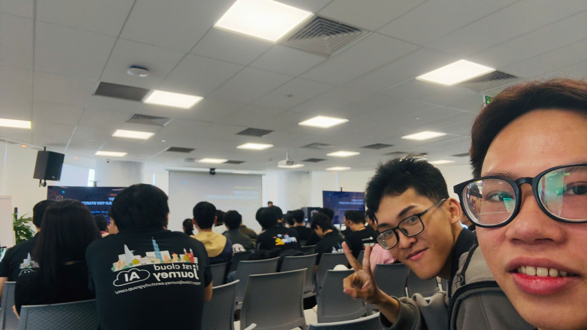
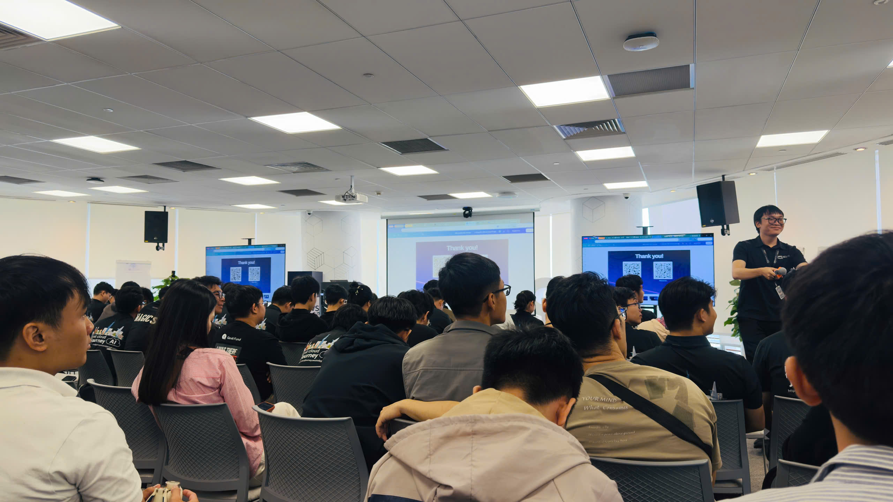
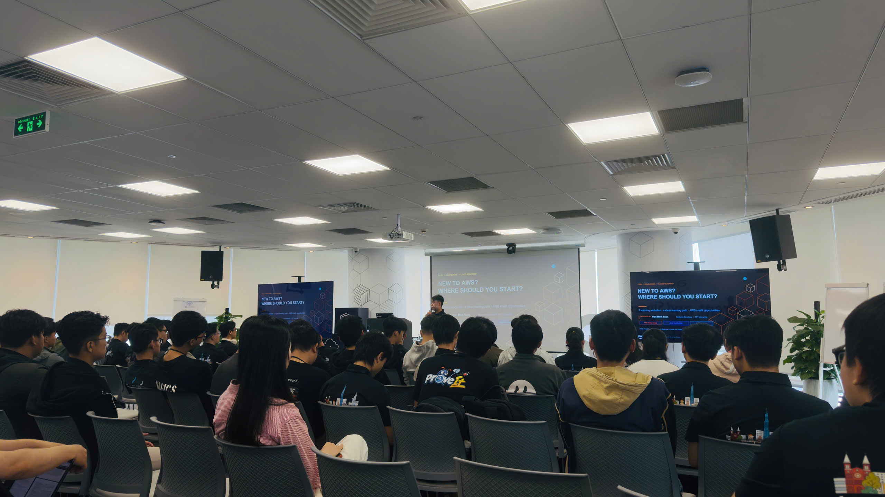
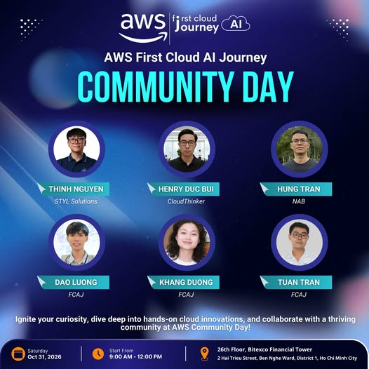

# Bài thu hoạch: "AWS First Cloud AI Journey Community Day 2026"

**Tên sự kiện:** AWS First Cloud AI Journey Community Day 2026

**Thời gian:** Thứ Bảy, 31/10/2026, từ 9:00 đến 12:00

**Địa điểm:** Tầng 26, Bitexco Financial Tower, 02 Hải Triều, phường Sài Gòn, TP. Hồ Chí Minh

**Vai trò:** Người tham dự

### Mục tiêu sự kiện
* Mang đến góc nhìn mới về công nghệ, từ những ý tưởng đột phá đến kinh nghiệm thực chiến.
* Thông qua các phiên chia sẻ ở nhiều lĩnh vực công nghệ, giúp người tham dự cập nhật kiến thức, mở rộng góc nhìn và kết nối với cộng đồng.
* Tạo dịp cho sinh viên và những bạn yêu thích công nghệ tìm cảm hứng, định hướng bản thân và chuẩn bị cho chặng đường sắp tới.
* Poster sự kiện ghi mục tiêu là khơi gợi sự tò mò, đi sâu vào điện toán đám mây thực hành và cùng làm việc với cộng đồng tại AWS Community Day.
* Buổi sáng có bốn phiên kỹ thuật: kinh nghiệm xây dựng web game serverless, Lambda Web Function, hệ thống bất đồng bộ với Amazon SQS và cách bắt đầu đóng góp mã nguồn mở.

### Diễn giả
* **Thinh Nguyen** - STYL Solutions
* **Henry Duc Bui** - CloudThinker
* **Hung Tran** - NAB, nằm trong top 25 người đóng góp cho AWS SDK, bắt đầu đóng góp mã nguồn mở từ khoảng 2 năm trước
* **Dao Luong** - FCAJ
* **Khang Duong** - FCAJ
* **Tuan Tran** - FCAJ

### Nội dung nổi bật

#### Kinh nghiệm xây dựng web game thẻ bài serverless trên AWS
Phiên này kể lại dự án web game thẻ bài đánh theo lượt, chơi thời gian thực, do một nhóm 4 người làm trong khoảng 3 tháng. Diễn giả giới thiệu Lambda là dịch vụ chạy hàm theo sự kiện, tức code chỉ chạy khi có sự kiện gửi tới.
* **Ba kiểu gọi Lambda:**
  * Gọi đồng bộ qua API Gateway: người dùng thao tác, API Gateway chuyển yêu cầu tới Lambda rồi chờ kết quả trả về.
  * Gọi theo sự kiện qua EventBridge. Diễn giả ví EventBridge như gọi điện đặt đồ ăn trước, tới giờ thì qua lấy, hoặc như cái đồng hồ hẹn giờ, đến giờ là reo. Dịch vụ này mạnh ở khoản phân luồng và lọc sự kiện.
  * Gọi bất đồng bộ qua SQS. SQS là hàng đợi tạm, giúp dữ liệu không đổ ồ ạt xuống cơ sở dữ liệu.
* **Xác thực:** người dùng đăng nhập qua Cognito để lấy JWT, sau đó mỗi yêu cầu gửi lên đều được đối chiếu JWT để xác thực.
* **Bảng xếp hạng:** cứ 10 phút, một tác vụ định kỳ đọc lại DynamoDB và cập nhật bảng xếp hạng, truy vấn dùng khóa GSI cho nhanh. Người chơi cũng có nút làm mới để cập nhật ngay mà không phải chờ đủ 10 phút.
* **Ví dụ 1000 trận kết thúc cùng lúc:** nếu ghi thẳng cả 1000 trận xuống cơ sở dữ liệu thì hệ thống có thể sập. Nhóm cho kết quả vào hàng đợi trước, rồi một Lambda lấy từng message ra ghi xuống dần. Lớp hàng đợi này giống như "sụn chêm" của hệ thống.
* **Vì sao chọn DynamoDB mà không chọn ElastiCache:** ElastiCache hợp với game cần chính xác tuyệt đối tới từng cú click, kiểu game bắn súng FPS. Game của nhóm cũng chạy thời gian thực nhưng không cần chính xác về thời gian tới mức đó, nên tốc độ đọc, ghi và phản hồi của DynamoDB là đủ. Diễn giả ví DynamoDB như một kệ sách xếp theo hàng, muốn lấy cuốn nào cũng dễ, còn GSI giống như chia sách ra từng khu để tìm nhanh hơn.
* **TypeScript và Lambda:** dự án viết bằng TypeScript, một ngôn ngữ mở rộng từ JavaScript. Theo diễn giả, Lambda của nhóm chỉ nhận mã JavaScript, nên nhóm phải build toàn bộ ra JavaScript chuẩn rồi mới tải lên Lambda.

#### Những sai lầm nhóm đã gặp và cách xử lý
* **Yêu cầu "ma" do long polling của SQS:** hệ thống có hai hàng đợi SQS, một hàng xử lý lúc trận đấu kết thúc, một hàng xử lý hết giờ trong trận. Lambda long polling liên tục, 20 giây một lần, kể cả khi không ai vào web. Diễn giả ví nó như nhân viên quán trà sữa cứ 20 giây lại chạy ra cửa xem có khách không rồi đi vào. Trong một tháng, chủ yếu do nhóm tự kiểm thử, hệ thống tiêu tốn xấp xỉ 863.000 yêu cầu, gần chạm hạn mức 1 triệu yêu cầu SQS của gói miễn phí. Nhóm bỏ hàng đợi hết giờ và dùng EventBridge làm "chó canh":
  * Nếu cả hai người chơi treo máy hoặc tắt tab lâu hơn thời gian cho phép của một lượt (diễn giả nêu khoảng 15 hoặc 30 giây), hệ thống ghi dữ liệu xuống rồi xóa sạch trận đấu, không để thừa gì.
  * Nếu chỉ một người treo máy thì trận đấu được giữ lại để chờ xử lý.
* **Một IAM Role chứa mọi policy:** nhóm gom hết quyền Lambda đến SQS, Lambda đến DynamoDB... vào chung một role, vi phạm nguyên tắc đặc quyền tối thiểu. Lẽ ra mỗi Lambda phải có role riêng, để khi một role có sự cố thì chỉ Lambda gắn với role đó bị ảnh hưởng, các Lambda khác không bị kéo theo.
* **Lưu khóa bí mật thẳng trong Lambda:** nhóm từng để cả khóa bí mật lẫn khóa truy cập ngay trong Lambda và tự nhận đây là sai lầm nghiêm trọng. Secrets Manager và KMS hợp với môi trường cần bảo mật cao, có VPC và cơ sở dữ liệu nằm trong VPC. Với DynamoDB thì nhóm chỉ cần cất khóa vào Systems Manager. Nhóm cũng gom tên các bảng vào một biến duy nhất trong Systems Manager, thay vì khai báo lại biến môi trường ở từng Lambda như trước. Cách cũ rất dễ lệch nhau, vì mỗi lần tạo Lambda mới lại phải khai báo lại đủ bộ biến.
* **Không dùng tính năng version của Lambda:** web lưu trữ trên Amplify với hai nhánh dev và main, nhưng hai nhánh dùng chung Lambda. Nhóm tưởng chỉ đẩy code lên dev thì main không sao, thực tế là hễ cập nhật code cho dev thì production cũng bị ảnh hưởng. Cách đúng là:
  * Khi một bản Lambda đã chạy ổn, chốt nó thành một version cố định cho production trên nhánh main.
  * Các lần cập nhật sau mặc định nằm ở $LATEST, tức bản mới nhất, và chỉ nhánh dev dùng bản này.
* **Lỗi môi trường khi dựng trên Amplify:** nhóm dùng Next.js phiên bản 19 và bị lỗi môi trường lúc triển khai. Repo không phải monorepo nên phần cấu hình biến môi trường trên Amplify rất quan trọng. Bài học là đọc tài liệu xem dịch vụ hỗ trợ phiên bản framework nào, đừng mặc định lấy bản mới nhất.
* **Ba tài khoản AWS cho một nhóm:** nhóm để Lambda và DynamoDB ở các tài khoản khác nhau. Muốn quản lý tập trung thì phải dùng AWS Organizations, khá tốn công và chi phí. Sau này nhóm định di chuyển, gom hết dịch vụ về một tài khoản.
* **Chuyển sang hạ tầng dạng code:** nhóm không muốn cấu hình tay từng dịch vụ trên AWS nữa nên chuyển sang CDK. Khi triển khai lên CloudFormation, toàn bộ dịch vụ được tạo tự động.
* **Kiến trúc sau cùng, theo luồng một trận đấu:**
  * Hai cổng API Gateway: HTTP cho các luồng GET/POST cơ bản, WebSocket cho luồng trận đấu thời gian thực.
  * Bước 1, kết nối: người chơi được cấp một ID, lưu cùng trận đấu. Lỡ mất mạng hay tắt tab thì hệ thống tra ID ra trận vẫn đang diễn ra và người chơi vào lại được.
  * Bước 2, đánh bài: mỗi lượt đánh được ghi vào DynamoDB, gồm người chơi nào đánh lá nào và hiệu ứng tăng, giảm đi kèm.
  * Bước 3, xử lý hết giờ: khi người chơi treo máy hoặc thoát, EventBridge xử lý trước rồi mới ghi xuống cơ sở dữ liệu.
  * Bước 4, kết thúc trận: kết quả vào hàng đợi, một Lambda khác lấy từng message ghi xuống cơ sở dữ liệu, còn bảng xếp hạng dùng khóa GSI để cập nhật nhanh hơn.
* **Trình diễn:** game có xây bộ bài, bộ sưu tập (thẻ chưa có thì hiện màu xám), tạo phòng chơi bằng mã, chế độ thử, xếp hạng, hồ sơ, tự đăng xuất khi đăng nhập ở tab khác, xử lý treo máy và cơ chế đầu hàng. Bàn chơi có hai hàng bài: hàng dưới là bài chờ, hàng trên là bài đang hoạt động. Thẻ bài và nhạc do một bạn họa sĩ trong nhóm làm. Game chưa được tối ưu cho điện thoại.
* **Lời khuyên cuối phần chia sẻ:** khi tìm hiểu một dịch vụ thì nên đọc tài liệu của nó, đừng chỉ dừng ở chỗ biết nó tích hợp được với dịch vụ nào. Phân quyền thì phải theo nguyên tắc đặc quyền tối thiểu.

#### Lambda Web Function và cách Lambda xử lý yêu cầu
* **Câu hỏi phỏng vấn "Lambda khác EC2 thế nào":** EC2 là máy chủ mình được toàn quyền sử dụng, còn Lambda chạy như một hàm. Có tính năng mới rồi thì câu trả lời này sẽ khác.
* **Hạn chế của cơ chế cũ:**
  * Mỗi yêu cầu được xử lý trong một môi trường riêng trên một microVM. Nhiều yêu cầu vào cùng lúc thì hệ thống bị cold start liên tục nên chậm.
  * API Gateway đóng gói yêu cầu thành một sự kiện JSON, Lambda phải có thêm một lớp chuyển đổi để giải mã, và bước này làm tăng độ trễ.
  * Lambda tính tiền theo thời gian từ lúc bắt đầu tới lúc kết thúc, kể cả lúc chỉ ngồi chờ cơ sở dữ liệu trả lời, ví dụ khi chạy một câu lệnh SELECT.
* **Giải thích cold start bằng biểu đồ 10 yêu cầu:**
  * Mỗi môi trường có hai giai đoạn là khởi tạo và thực thi. Cold start nằm ở giai đoạn khởi tạo, khi Lambda phải dựng microVM và chuẩn bị môi trường rồi mới chạy hàm.
  * Yêu cầu 1, 2, 3 đều bị cold start. Yêu cầu 4, 5 tới khi các môi trường cũ chưa xử lý xong nên cũng phải khởi tạo môi trường mới.
  * Yêu cầu 6, 7, 8 tới lúc các môi trường đầu tiên đã rảnh và còn "ấm", nên được dùng lại luôn mà không phải khởi tạo.
  * Yêu cầu 9 tới khi môi trường nào cũng đang bận nên lại phải khởi tạo mới. Yêu cầu 10 tới lúc môi trường thứ tư vừa xong nên dùng lại môi trường đó.
  * Tóm lại, còn môi trường rảnh thì Lambda ưu tiên dùng lại, hết môi trường rảnh thì mới khởi tạo môi trường mới.
* **Lambda Web Function:**
  * Code và môi trường được đóng gói thành Docker image, mở cổng để gọi tới.
  * Bên trong có thể dùng Express hoặc FastAPI để định tuyến API, nên gần như không cần API Gateway nữa.
  * Hỗ trợ nhiều yêu cầu đồng thời: một microVM chịu được 128 yêu cầu cùng lúc. Cold start vẫn có vì cơ chế co về 0 khi không có yêu cầu, nhưng chỉ ở yêu cầu đầu tiên. Có 129 yêu cầu cùng lúc thì Lambda dựng thêm microVM thứ hai, tải lớn hơn nữa thì cứ thế nhân thêm microVM.
* **CloudFront OAC:** yêu cầu đi thẳng từ CloudFront vào Lambda, Lambda không phải công khai ra internet, và bỏ được bước API Gateway cùng chi phí đi kèm.
* **Cách tính tiền mới:** chỉ tính thời gian CPU xử lý, không tính lúc chờ cơ sở dữ liệu. Theo phiên chia sẻ, cách này có thể giảm khoảng 40 đến 70% chi phí.
* **Trình diễn:**
  * Một web trắc nghiệm MBTI dùng CloudFront, S3 và Lambda, thêm ECR để lưu image sau khi build. Web được truy cập qua đường dẫn của CloudFront, người tham dự quét mã QR để vào thử.
  * Theo bản ghi, yêu cầu đầu tiên mất khoảng 186 giây vì phải kéo image, khởi động container rồi mới chạy backend. Hơn 10 yêu cầu sau đó chỉ mất khoảng 138 mili giây.
  * Khi chạy thật với lượng yêu cầu đều đặn, container luôn được giữ ấm nên cold start sẽ không xảy ra thường xuyên.
* **Hỏi đáp: khi nào dùng Lambda cũ, khi nào dùng Lambda Web Function?**
  * Tác vụ đơn giản như tạo S3 URL, gửi thông báo kết hợp EventBridge hay mấy việc tự động hóa nhỏ thì dùng Lambda cũ, vì không cần đóng gói container.
  * Lambda Web Function cold start lâu hơn vì phải kéo image và chạy container.
  * Lambda Web Function vẫn giữ giới hạn chạy tối đa 15 phút của Lambda.

#### Xây dựng hệ thống bất đồng bộ với Amazon SQS
Phiên có bốn phần: đồng bộ là gì, bất đồng bộ là gì, SQS, và hỏi đáp.
* **Bài toán thực tế:** nhóm có tích hợp một AI service để sinh nội dung. Gọi trực tiếp thì người dùng phải đứng chờ AI trả về, không rời trang được, rời trang là mất kết quả. Nhóm cân nhắc giữa SQS và một hàng đợi message khác, cuối cùng chọn SQS làm trung gian:
  * API service đẩy message vào hàng đợi rồi trả về ngay trạng thái đang chờ cho người dùng.
  * AI service lấy message ra xử lý.
  * Hai service tách riêng nên hệ thống tách biệt, dễ mở rộng hơn, và người dùng có thể rời trang trong lúc chờ.
* **Khái niệm SQS:**
  * Bên gửi đẩy message vào hàng đợi, bên nhận lấy message ra xử lý.
  * Các lợi ích được nhắc tới gồm bảo mật, khả năng mở rộng và độ bền nhờ lưu nhiều bản sao của message.
* **Standard và FIFO:**
  * Standard có thể xử lý không theo thứ tự: gửi 1, 2, 3 nhưng chưa chắc xử lý đúng 1, 2, 3.
  * FIFO giữ đúng thứ tự gửi. Message cùng group ID phải chờ nhau, nên thông lượng FIFO thấp hơn Standard. Ví dụ trong phiên: message 1 và 4 có group ID 1, message 2 và 3 có group ID 2. Khi message 1 đang được xử lý thì message 4 phải chờ, tương tự message 3 phải chờ message 2. Với Standard thì bốn message được xử lý mà không phải chờ nhau.
* **Visibility timeout:** là khoảng thời gian bên nhận được giữ message để xử lý. Ví dụ trong phiên đặt timeout là 40: bên nhận xử lý quá thời gian này thì message sẽ được giao cho bên nhận khác, dễ dẫn tới xử lý trùng. Cách khắc phục là gia hạn thêm khi sắp hết thời gian.
* **Long polling:** thay vì hỏi liên tục, bên nhận chờ tối đa 20 giây. Hàng đợi có message thì lấy về ngay, hàng đợi rỗng thì hết 20 giây mới trả về phản hồi rỗng. Nhờ vậy số yêu cầu lên hàng đợi giảm đi.
* **Dead letter queue:** message bị thử lại quá số lần cho phép sẽ chuyển sang DLQ để người hoặc Lambda xử lý riêng, tránh thử lại liên tục làm hệ thống quá tải.
* **Trình diễn trên console:**
  * Tạo hàng đợi tên MyQ, chọn loại Standard.
  * Đặt visibility timeout là 30.
  * Xem các tùy chọn thời gian lưu giữ message và thời gian chờ khi nhận message, tức long polling.
  * Dead letter queue mặc định tắt. Khi bật thì chọn hàng đợi đích và số lần thử tối đa, trong phần trình diễn thì để tắt.
  * Tạo hàng đợi, gửi một message rồi kéo message về ngay trên console.
* **Trình diễn bằng code:**
  * Khởi tạo SQS client để kết nối tới SQS, chỉ định tên hàng đợi.
  * Gửi message, console in ra message ID, kiểm tra trên giao diện thấy hàng đợi đã nhận message.
  * Nhận message ra xử lý, xong thì xóa message khỏi hàng đợi.
* **Kết hợp SNS:** muốn phân phối một message tới nhiều hàng đợi, ví dụ máy chủ đẩy log tới hai service cùng lúc, thì có thể kết hợp SNS với SQS.
* **Hỏi đáp:** một bạn hỏi với web thương mại điện tử, nếu thanh toán đã thành công nhưng bên nhận gặp lỗi trước khi xóa message khỏi SQS thì làm sao để khách hàng không bị thanh toán hai lần. Câu hỏi chưa được trả lời trọn vẹn trong phiên, hai bên hẹn trao đổi tiếp sau buổi.

#### Bắt đầu đóng góp mã nguồn mở
Diễn giả chia hành trình đóng góp thành từng chặng: PR đầu tiên, PR thứ 10, PR thứ 100, và làm sao duy trì việc đóng góp khi ai cũng có công việc riêng.
* **Thực tế lúc mới bắt đầu:**
  * Tùy repo, có khi mất khoảng 6 tháng mới có vài dòng code được merge. Project lớn có ảnh hưởng rộng và chu kỳ phát hành riêng, nên gửi PR chưa chắc đã được nhận.
  * Ở các repo lớn, issue dễ thường bị người khác nhận rất nhanh, có khi chỉ trong nửa tiếng đến một tiếng.
  * Mấy project nổi tiếng mình đang dùng chưa chắc đã là chỗ hợp để bắt đầu.
* **Cách tìm việc đầu tiên:**
  * Tìm các nhãn như "good first issue" hay "ready to implement". Đây là những việc rõ ràng mà người duy trì project cố tình để lại cho người mới làm quen với quy trình. Ở project lớn, một báo lỗi còn phải được sàng lọc xem có đúng là lỗi không và sửa có gây lỗi khác không, nên người mới chỉ nên nhận những việc đã rõ ràng.
  * Một mẹo khác là tìm các đợt tái cấu trúc lớn đã có sẵn mẫu và danh sách việc dạng ô đánh dấu, rồi nhận làm từng phần nhỏ. Diễn giả lấy hai repo làm ví dụ: một repo có thể vào làm được ngay, repo còn lại đã mở đợt tái cấu trúc nhiều năm.
* **Để PR được merge:**
  * PR càng đơn giản, dễ hiểu càng tốt. Người review không biết mình là ai, mà merge xong thì lỗi là trách nhiệm của họ, nên mình phải giúp họ đỡ phải nghĩ nhiều nhất có thể.
  * Chia nhỏ PR. PR làm quá nhiều thứ mà người review không hiểu vì sao thì khó được merge.
* **Chương trình hướng dẫn cho người mới:**
  * Loại có trả tiền và có người hướng dẫn, mỗi năm chỉ khoảng ba đợt, đòi hỏi làm gần như toàn thời gian, hợp với sinh viên hoặc người làm tự do.
  * Loại gặp mặt người đóng góp mới hằng tháng, chủ yếu để giới thiệu và trao đổi, không giao việc sẵn mà mình phải tự tìm.
* **Cạm bẫy:** phần lớn người mới bị "kẹt" ở good first issue, nhảy hết project này sang project khác mà không đi sâu vào project nào.

### Những gì học được
* **Chọn kiểu gọi dịch vụ theo bản chất công việc:**
  * Yêu cầu cần trả lời ngay thì gọi đồng bộ qua API Gateway.
  * Việc chạy theo lịch hoặc theo sự kiện, như xử lý hết giờ hay treo máy, thì dùng EventBridge.
  * Cần giảm tải cho cơ sở dữ liệu hoặc tách các service chậm như AI thì dùng SQS. Hàng đợi là lớp đệm giúp hệ thống không sập khi tải dồn vào cùng lúc.
* **Dịch vụ "miễn phí" vẫn có thể tốn tiền nếu không hiểu cơ chế:** long polling 20 giây đã tạo ra khoảng 863.000 yêu cầu trong khi gần như không có người dùng thật, sát hạn mức 1 triệu yêu cầu SQS của gói miễn phí. Mình rút ra là phải ước lượng số yêu cầu theo cách dịch vụ hoạt động, chứ không chỉ theo số người dùng.
* **Bảo mật và vận hành:**
  * Mỗi Lambda một IAM Role, theo nguyên tắc đặc quyền tối thiểu.
  * Không để khóa bí mật trong code hay rải rác trong biến môi trường. Cất vào Systems Manager, hoặc Secrets Manager và KMS khi cần bảo mật cao trong VPC.
  * Dùng version của Lambda để tách dev với production: production chốt một version, dev dùng $LATEST.
  * Quản lý hạ tầng bằng CDK và CloudFormation thay vì cấu hình tay.
* **Hiểu cold start và các đánh đổi của Lambda:**
  * Cơ chế cũ: mỗi yêu cầu một môi trường, môi trường gồm giai đoạn khởi tạo và thực thi, cold start nằm ở khởi tạo. Môi trường còn ấm thì được dùng lại.
  * Lambda Web Function: container xử lý tới 128 yêu cầu đồng thời trên một microVM, có thể bỏ API Gateway khi dùng CloudFront OAC, chỉ tính tiền thời gian CPU.
  * Bù lại, lần khởi động đầu chậm hơn, nên tác vụ nhỏ vẫn nên dùng Lambda thường. Cả hai đều giới hạn chạy tối đa 15 phút.
* **Các chi tiết cấu hình của SQS:** chọn Standard hay FIFO, visibility timeout, long polling và DLQ đều ảnh hưởng thẳng tới tính đúng đắn và chi phí. Xử lý trùng message là rủi ro có thật, cần tính tới ngay từ lúc thiết kế. Quy trình cơ bản là gửi message, nhận ra xử lý, xử lý xong thì xóa khỏi hàng đợi.
* **Đóng góp mã nguồn mở:** cần kiên nhẫn. Nên bắt đầu từ việc nhỏ và rõ ràng, giữ PR đơn giản, và gắn bó lâu dài với một project.
* **Đọc tài liệu chính thức trước khi dùng một dịch vụ:** các phiên nhắc lại chuyện này nhiều lần, cả về khả năng tích hợp lẫn phiên bản framework được hỗ trợ.

### Áp dụng vào công việc
* Trước khi dùng SQS cho workshop, mình sẽ ước lượng số yêu cầu mà long polling tạo ra ngay cả lúc không có người dùng, và đặt cảnh báo AWS Budgets cho số yêu cầu đó. Việc nào chỉ cần chạy khi có sự kiện hoặc theo lịch thì mình chuyển sang EventBridge, không để Lambda hỏi hàng đợi liên tục.
* Mỗi Lambda trong workshop sẽ có IAM Role riêng, chỉ mang đúng quyền nó cần, để một role có vấn đề thì không kéo theo các hàm khác.
* Mình không ghi khóa bí mật vào code hay biến môi trường của từng hàm. Cấu hình dùng chung để ở Parameter Store, còn mật khẩu và khóa cần xoay vòng để ở Secrets Manager.
* Với hàng đợi SQS, mình sẽ đặt visibility timeout dài hơn thời gian xử lý một message, bật dead letter queue, và viết bên nhận sao cho xử lý trùng một message cũng không gây sai, ví dụ không tạo hai lần thanh toán.
* Mình sẽ dựng hạ tầng workshop bằng CloudFormation hoặc CDK thay vì bấm tay trên Console, để dựng lại và dọn dẹp tài nguyên được trọn vẹn.
* Mình sẽ dùng version và alias của Lambda để tách dev với production, và đọc tài liệu về phiên bản framework được hỗ trợ trước khi triển khai lên Amplify.

### Trải nghiệm sự kiện
* Mình nhớ nhất con số khoảng 863.000 yêu cầu "ma" do long polling, trong khi gần như không có người dùng. Kiểu lỗi này chỉ lộ ra khi làm dự án thật, đọc lý thuyết thì khó thấy.
* Biểu đồ 10 yêu cầu giúp mình hiểu rõ khi nào Lambda phải khởi tạo môi trường mới và khi nào được dùng lại môi trường đang "ấm".
* Câu hỏi về chuyện khách hàng có thể bị thanh toán hai lần chưa được trả lời ngay trong phiên. Mình ghi lại để tự tìm hiểu thêm cách xử lý trùng message trong SQS.
* Phiên về đóng góp mã nguồn mở cho mình thêm một hướng để rèn kỹ năng: bắt đầu từ những issue nhỏ, rõ ràng, và gắn bó lâu với một project.

#### Hình ảnh sự kiện

*Hình 1: Check-in tại AWS First Cloud AI Journey Community Day 2026*

*Hình 2: Diễn giả kết thúc phiên chia sẻ, màn hình hiện slide "Thank you!" kèm mã QR để kết nối*

*Hình 3: Phòng hội thảo kín chỗ trong phiên "New to AWS? Where should you start?"*

*Hình 4: Poster sự kiện với sáu diễn giả, diễn ra thứ Bảy 31/10/2026 từ 9:00 đến 12:00 tại tầng 26 Bitexco Financial Tower*

<!-- Kiểm tra: Không có ghi chép riêng của bạn trong sources.md, và Key learning / Reflection trong record vẫn trống, nên trang này không có nhận định nào chỉ dựa trên ghi chép của bạn. Các phần "Áp dụng vào công việc" và "Trải nghiệm sự kiện" cần bạn tự viết. Những điểm cần đối chiếu thêm: (1) ai là diễn giả phiên web game, vì bản ghi chỉ nhắc "bạn Khang" nói về Lambda trước đó; (2) "anh Thành" trong bản ghi có phải Thinh Nguyen trên poster hay không; (3) tên diễn giả trên slide "New to AWS?" đọc không rõ, cần đối chiếu với Tuan Tran trên poster; (4) con số cold start "186 giây" có thể do bản ghi tự động nghe nhầm; (5) phiên của Henry Duc Bui không có trong bản ghi. -->
